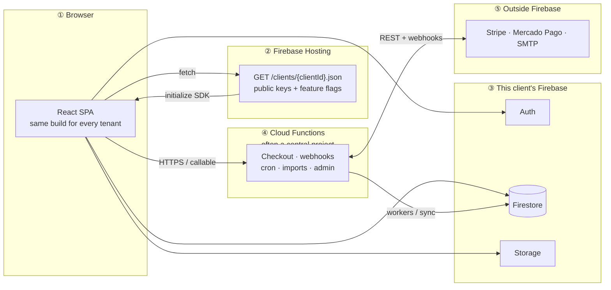

# Realwise

**Realwise** is a multi-tenant personal finance PWA: one deployed web app serves many isolated clients. Each client gets their **own Firebase project** (Authentication + Firestore + Storage for that tenant). Runtime config and feature flags live in static JSON per client under `public/clients/`.

Public URL shape: **`https://realwise.com.br/{clientId}/dashboard`** (path-based tenant — no per-client subdomains required, though subdomain extraction is supported for local/dev hostnames).

---

## System architecture (end-to-end)

### Read this first (what the diagram tried to say)

There are **three separate ideas**:

1. **One deployed web app** — Firebase Hosting serves the **same** React build (HTML/JS) to everyone.
2. **Which customer (“tenant”) you are** — The URL picks a **small JSON file** such as `/clients/acme.json`. That file tells the app **which Firebase project** to use and **which feature flags** are on. It uses normal public Firebase web keys (same idea as embedding config in any SPA).
3. **Where your money data lives** — After loading that JSON, the browser connects to **that customer’s own** Firebase: Auth + Firestore + Storage. A different URL → different JSON → **different** Firebase project, so databases stay isolated.

**Cloud Functions** (payments, reminder emails, import processing, etc.) often run in a **separate central Firebase project** because that’s where API secrets live (Stripe, Mercado Pago, SMTP). Those functions call **Stripe/Mercado Pago** over the internet and may read/write Firestore depending on the flow. **Bill reminders use email (SMTP)** in this repo, not SMS.

### Picture in plain text

```
    YOU (browser)
         |
         |  download SPA once from Hosting
         v
+----------------------+
|   Firebase Hosting    |   same site for every tenant
|   index.html + JS     |
+-----------+----------+
            |
            |  fetch /clients/{clientId}.json
            v
      +-----------+
      | tiny JSON |  → Firebase keys + feature flags for THIS tenant
      +-----------+
            |
            |  initializeFirebase(...)
            v
+---------------------------+
| This tenant's Firebase     |   only this customer's users & data
| Auth · Firestore · Storage |
+---------------------------+
            ^
            |  HTTPS (when needed)
+---------------------------+
| Cloud Functions           |   checkout webhooks, cron emails,
| (often central project)   |   import pipeline, admin tools, …
+---------------------------+
```

### Step-by-step (same as above, numbered)

1. **Tenant resolution** — The first path segment (`clientId`) or a hostname like `clientId.realwise.com.br` selects which JSON config to load (`fetch('/clients/{clientId}.json')`).
2. **Lazy Firebase init** — `ClientConfigContext` loads config, then calls `initializeFirebase()` so each tenant talks to **their** Firebase project (not at module load time).
3. **Router basename** — `BrowserRouter` uses `basename="/${clientId}"` so in-app routes are stable (`/dashboard`, `/bills`, …).
4. **Data isolation** — User documents use `userId`; **shared accounts** use `ownerId` from `AccessContext` so delegated users see the same data without duplicating it.

### Optional: visual diagram for GitHub / Mermaid preview

If your editor shows the block below as **raw code**, ignore it or open this README on **GitHub**, which draws it as a chart.



### Backend vs “serverless” split

| Layer | What runs where |
|--------|------------------|
| **UI & business logic** | React 19 SPA (mostly client-side; bank PDF parsing, categorization rules, charts). |
| **Primary database** | Firestore **in each client’s Firebase project** — transactions, bills, settings, planner, cards/banks, goals, investments, etc. |
| **Auth** | Firebase Auth **per client project** (email/password, Google; popup handler at `/__/auth/handler`). |
| **File imports** | Uploads to Storage; optional **Cloud Functions** process imports and write Firestore (see `functions/importProcessor.js`). |
| **Payments & sales ops** | Cloud Functions in the **deployment project** (Stripe checkout + webhook, Mercado Pago payment + webhook, admin onboarding — see Integrations). |
| **Reminders & sync** | Scheduled jobs: **daily bill reminder emails**, **B3 investment sync** on a schedule + manual callable sync. |

### Deploying functions per client vs central stack

- **`functions/index.js`** — Full surface: payments, imports, Stripe, Mercado Pago, B3, admin, seamless login, etc. Usually deployed to the **central** Firebase project that holds secrets (Stripe, SMTP, Mercado Pago).
- **`functions/clientIndex.js`** — Minimal entry that only exposes **`scheduledBillReminders`**, used with `scripts/deploy-client-functions.sh` so a **client project** can run bill reminders without pulling in unrelated secrets.

---

## Integrations (what is used)

| Integration | Role in Realwise | Feature flag |
|-------------|-------------------|--------------|
| **Firebase Auth** | Login; user identity for Firestore rules | — |
| **Cloud Firestore** | All app data | — |
| **Cloud Storage** | Bank/import file uploads | — |
| **Cloud Functions** | Payments, webhooks, scheduled jobs, import pipeline, admin | — |
| **Email (SMTP, e.g. Umbler)** | Purchase notifications, bill reminder digests, admin/import emails | — |
| **Stripe** | Landing/checkout sessions, webhook → leads/purchases, discount checkout (admin) | — |
| **Mercado Pago** | Alternative checkout path (`createPayment` / `processPayment` / `mercadoPagoWebhook`) | — |
| **WhatsApp** | **Not** a live Cloud API bill-bot in this repo’s exported functions. Landing/checkout collects **WhatsApp as contact** (Stripe metadata). Support-style **wa.me** link exists in `WhatsAppButton.jsx`. The **`whatsapp` client flag** is defined in JSON but **not** used to gate UI in `src/` today. | `whatsapp` (reserved / future) |
| **SMS** | Not integrated | — |
| **Brapi.dev** (via backend) | B3 quotes/dividends sync for investments | `b3Sync` (UI + manual sync) |

---

## Feature flags (`public/clients/_template.json`)

Flags live under `features` in each client’s JSON. Defaults are **false** in the template; dev mode can enable all via `buildDevConfig()` in `src/config/clientConfig.js`.

| Flag | Default | What it controls |
|------|---------|------------------|
| `investments` | false | Routes and flows for **Investments** (`/investments`, forms). `InvestmentProvider` still loads for dashboard summaries where applicable. |
| `goals` | false | **Goals** route and goal-related dashboard UI (e.g. `GoalProgress`). |
| `b3Sync` | false | **B3 sync** UI in import modal + server-side sync (`syncB3Investments`, `syncB3InvestmentsCallable`). |
| `salaryBreakdown` | false | **Planner → Renda tab**: gross salary + deduction lines vs single net salary. |
| `whatsapp` | false | Present in config schema; **no `useFeature('whatsapp')` in the React tree** — reserved for future server/UI behavior. |

Usage: `const on = useFeature('investments')` from `ClientConfigContext`.

---

## Product features (by area)

### Money in / out

- **Income & Expenses** — Dedicated pages; filters by month; ties to **global month** context.
- **Transactions** — Full list, create/edit, categories, banks/cards; supports credit-card **purchase vs payment month** logic via `CardsContext`.
- **Dashboard** — Summary cards, income vs expenses, category breakdown, trends, bills snapshot, planner summary; optional **goals** widget when `goals` is on.
- **Import** — CSV/PDF pipelines, Brazilian bank formats (Nubank, Itaú, Bradesco, Inter, Mercado Pago CSV/PDF, etc.), categorization rules, optional **B3** sync when enabled.

### Planning

- **Planner** (`/planner`) — Tabs: **Renda** (salary; breakdown behind `salaryBreakdown`), **Alocação**, **Carteira** / tracking — uses `planner` + `transactions`.
- **Planning** (`/planning`) — Higher-level planning UI (distinct from Planner page).
- **Budget** (`/budget`) — Budget vs actual using `budgets` + transactions.

### Bills & cards

- **Bills** (`/bills`) — Due dates, paid/pending, recurrence; ties to **bill reminder** emails (function + `settings.billReminders` opt-out).
- **Cards** (`/cards`) — Card-centric views and bill generation (`CardsContext`, `bills`).
- **Banks** (`/banks`) — Institutions / accounts overview.

### Investments & goals (partially gated)

- **Investments** — Positions, B3-sourced data when configured, withdrawals as transactions (`investments` flag).
- **Goals** — Savings targets linked to activity (`goals` flag).

### Settings & profile

- **Settings** — Currency, language (EN/PT), categories, preferences, dark mode, bill reminders toggle, etc.
- **Category / bank settings** — Nested routes under settings.

### Other UX

- **Notifications** page; **Help**; **PWA install** hints (`PWAInstallContext`).
- **Onboarding** wizard driven by `onboardingSteps.js` + Firestore-backed profile hook.
- **Landing** (`/`) and **purchase success** (`/purchase-success`) — **no tenant Firebase** until user enters a client app; checkout talks to **Cloud Functions** for Stripe/Mercado Pago.
- **Shared login** (`/login`) — Cross-tenant entry when applicable.
- **Admin** (`/admin/*`) — Leads, onboarding, import issues, etc. (uses central/admin Firestore collections such as `leads`, `purchases`).

---

## Tech stack

- **Frontend:** React 19, Vite, Tailwind CSS v4, React Router v7  
- **Backend (managed):** Firebase (Auth, Firestore, Storage, Functions)  
- **i18n:** Custom locale files under `src/locales/`  
- **Tests:** Vitest — pure functions only (`npm run test` / `npx vitest run src/`)

---

## Commands

```bash
npm install
npm run dev          # http://localhost:5173 — dev uses /clients/app.json + shared Firebase app
npm run build
npm run lint
npm run preview
npx vitest run src/
```

### Firebase Functions (`/functions`)

```bash
cd functions && npm install
firebase deploy --only functions
```

Secrets (examples): `EMAIL_USER`, `EMAIL_PASSWORD`, `EMAIL_HOST`, `EMAIL_PORT`, `STRIPE_SECRET_KEY`, `STRIPE_WEBHOOK_SECRET`; Mercado Pago via `functions.config().mercadopago`; WhatsApp Cloud config was described historically but **no WhatsApp webhook is exported** from `functions/index.js` today.

---

## Local multi-tenant testing

- Default dev: `http://localhost:5173` with **`/clients/app.json`** (see `ClientConfigContext`).
- Tenant-style URL: `http://localhost:5173/{clientId}/dashboard` (requires `public/clients/{clientId}.json`).

---

## Adding a new client

1. Create a dedicated **Firebase project** for that customer (Auth + Firestore + Storage + rules).
2. Copy `public/clients/_template.json` → `public/clients/{clientId}.json`.
3. Fill Firebase web config and set `features` as needed.
4. Deploy hosting so `/clients/{clientId}.json` is published.

---

## Security notes

- Firestore rules must enforce `userId` / `ownerId` patterns used in the app.
- Client JSON exposes **public** Firebase web keys only (expected).
- Payment secrets stay in **Functions** config / Secret Manager, not in the SPA.

---

## License

MIT License.
