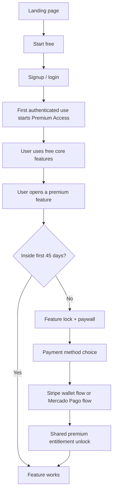

# Design: Free Core, Premium Access, Dual-Provider Checkout

**Date:** 2026-07-02  
**Status:** Approved for planning

## Summary

Realwise will stop selling the product on the landing page before the user experiences it. The product will instead use a `free core + premium access` model:

- `Free forever`: manual transactions, statement import, dashboard, history, category spending/income visibility
- `Premium for first 45 days`: bills, planning, investments, and guidance derived from planning limits
- `After 45 days`: premium features lock, but the free core remains usable

Payment routing will optimize for the least-friction method:

- `Apple Pay / Google Pay` → Stripe
- `Pix` → Mercado Pago
- `Manual card entry` → Mercado Pago

The landing page will shift from checkout-first to activation-first. Primary CTAs will send the user into the product, not into payment.

## Product Decisions Locked

### Premium start date

Premium access begins on the user's first authenticated app session, not on landing-page visit.

### Feature matrix

**Free forever**

- manual transaction creation and editing
- statement import
- dashboard and historical data
- expense/income by category
- category totals and trends

**Premium during the first 45 days**

- bills setup and bill workflows
- planning configuration and usage
- investments setup and tracking
- "how much is left to spend" guidance
- category limits and remaining budget signals

### Post-trial behavior

Premium modules become read-only or locked after day 45, but the app does not globally expire. Users keep access to free features.

### Purchase structure

The implementation plan should treat premium purchase as one shared entitlement regardless of payment provider. Stripe and Mercado Pago differ only in checkout collection and webhook handling.

### Landing page positioning

The landing page should clearly state:

- tracking and import stay free
- premium access covers planning, bills, investments, and spending guidance
- the main CTA is `Start free`

## User Experience Model



## Premium Messaging Rules

The app must never imply that the entire system expires.

Use:

- `Premium Access`
- `Core tracking stays free`
- `Planning, bills, and investments are premium`

Avoid:

- `Your app access ends`
- `Trial expires` without premium context
- `System locked`

## Key Visual States

### Global soft banner

```text
Premium Access: 18 days left
Bills, Planning, and Investments are included for now.
Manual tracking and imports stay free forever.
[See premium features]
```

### Premium feature banner

```text
Included in Premium Access
This feature is available for your first 45 days.
Manual tracking and import remain free after that.
[Upgrade before it ends]
```

### Premium lock state

```text
Premium feature locked

Your 45-day Premium Access for advanced tools has ended.

You still have free access to:
- manual transactions
- statement import
- dashboard and history

Unlock Premium to use:
- Bills
- Planning
- Investments

[Unlock Premium]
[Keep using free features]
```

## Category Guidance Split

Free users can understand what happened. Premium users can understand what they can still do.

**Free users can see**

- amount spent per category
- amount earned per category
- category ranking and trends

**Free users cannot see**

- remaining category budget
- safe amount left to spend
- over-budget status derived from planning
- configured category limits

This creates a strong product distinction:

- `Free = tracking`
- `Premium = guidance`

### Free category card concept

```text
Food
Spent: R$ 820

Unlock Planning to see:
- remaining budget
- category targets
- safe amount left this month

[Unlock Premium]
```

## Landing Page Changes

### New landing goal

The landing page should activate users, not close payment immediately.

### CTA hierarchy

- primary CTA: `Start free`
- secondary CTA: `See premium features`

### Content shift

Replace one-time purchase positioning with a free-vs-premium product comparison.

### Free vs premium comparison

```text
FREE
- Manual transactions
- Statement import
- Dashboard
- Category insights

PREMIUM
- Bills
- Planning
- Investments
- Remaining budget guidance
```

### FAQ changes

The FAQ must stop describing the product as a one-time purchase that grants all current features forever. It should explain:

- free core access
- premium feature set
- how payment unlocks advanced tools

## Payment Method UX

### Payment chooser

```text
Unlock Premium

Choose the fastest way to pay:

[Apple Pay]
[Google Pay]
[Pix]

Other option
[Pay with card]
```

### Routing

- Apple Pay and Google Pay route to Stripe
- Pix routes to Mercado Pago
- Manual card entry routes to Mercado Pago

### Provider-specific flows

**Stripe**

- wallet-first flow
- no manual card typing promoted in the first step

**Mercado Pago**

- Pix as the first provider-specific option
- manual card entry kept as fallback

### Shared success state

```text
Premium unlocked

Bills, Planning, and Investments are now available.
Core tracking remains active as always.

[Continue]
```

## Data and Entitlement Model

Both payment providers must end in one shared premium result.

Required concepts:

- premium access started at
- premium access ends at
- premium purchase status
- payment provider
- provider payment id

This entitlement state should drive:

- feature gating
- banners
- lock states
- unlock after payment

## Migration Implications

The repo currently reflects a mixed historical checkout surface. The refactor should intentionally normalize:

- landing page to activation-first
- in-app premium paywall as the canonical purchase path
- Stripe webhook URL refresh
- shared post-payment entitlement handling for Stripe and Mercado Pago

## Success Criteria

- Users can start using Realwise without paying first
- Landing page no longer pushes immediate checkout
- Free users understand the value of premium without feeling the app has expired
- Category charts still help free users without leaking planning-derived guidance
- Stripe and Mercado Pago unlock the same premium entitlement
- Premium messaging is explicit that free tracking and import remain available
